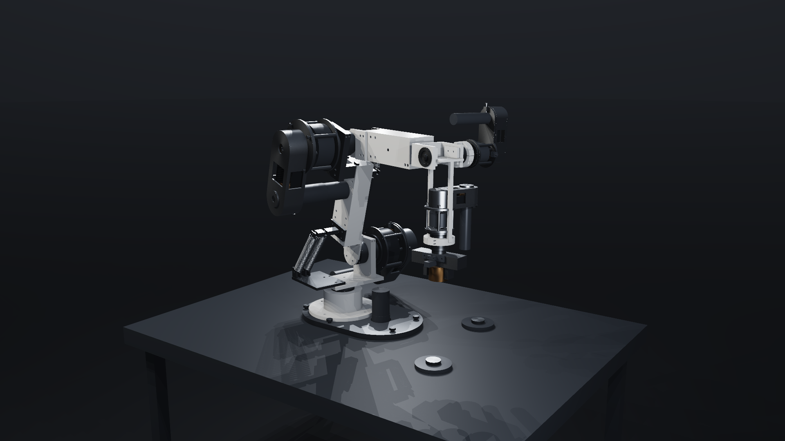
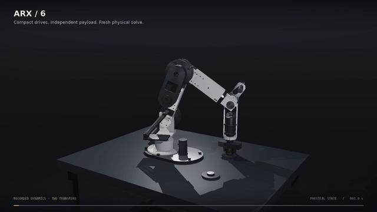

# ARX / 6 · belt-drive P5

A six-axis robot-arm engineering study with folded motor/reducer assemblies, six 1:1 toothed-belt transmissions, spring counterbalances, an opposed-rack gripper, and a contact-driven independent payload. This repository preserves the actual CAD, MuJoCo, control, validation and constructive-shader code, together with the later 30-second action-film companion.





The still is the belt model's original 1080p render. The GIF is a 640-pixel, 10 fps excerpt from seconds 1–6 of its 30-second, 1920×1080, 24 fps action film. These are project renders, not physical-hardware footage or generated concept art.

## Status

**Engineering prototype. Not manufacturing-ready or safety-certified.** The archived suite reports 21 of 24 ordinary scenarios passing, with all four deliberately adverse controls producing their expected consequences. The three unresolved ordinary failures are preserved:

- `power_loss_3.2`: J4 transmitted belt load exceeds its selected service allowance.
- `weak_spring_double_delay_3.2`: descent impact overloads, including J3/J5 exceeding raw catalog torque screens.
- `weak_spring_double_delay_7.2`: J4 misses the 0.5-second settling deadline.

The archived 30-second nominal solve completes six transfers with reported placement errors of 0.250–0.769 mm against a 1.5 mm criterion. That does not establish indefinitely drift-free operation, physical accuracy, or survival after an overload. Publication review inspected source/data and decoded media; it did not rerun CAD, simulation, graphics or hardware tests.

## Architecture and source map

The engineering files below are under `ARX-6-P5-Engineering/integration/`.

| Layer | Actual source | Responsibility |
| --- | --- | --- |
| Design inputs | `spec.json`, `P5-component-reference.json` | Dimensions, limits, candidate component envelopes, belts, brakes and springs |
| Native construction | `generate_cad_p2.py` | Current P5 CadQuery generator despite its historical filename; solids, materials, placed BOM, mass and inertia |
| Collision material | `build_p5_collision_proxies.py` | 2,095 recorded material-region primitives; bores remain open rather than using cavity-filling hulls |
| Dynamics model | `build_p5_model.py`, `ARX-6-P5.xml` | CAD inertias, articulated/contact topology, joints, gripper equality/tendon and independent free puck |
| Causal actuation | `controller.mjs` | Torque reference tracking, electrical current/back-EMF, voltage limits, gear/belt screens, gripper motor, heat and energy |
| Fault response | `safety.mjs` | Run, controlled stop, hold and emergency states; watchdog, feedback, travel and power-loss handling; delayed brakes |
| Physical checks | `validate_p5*.py`, `validate_p5.mjs`, `check_p5_*.mjs` | Native fits, stop geometry, posed interfaces, springs, clearance and fault scenarios |
| Inspection renderer | `../../ARX-6-P5-Shader/source/`, `../../ARX-6-P5-Shader/tools/` | Captured CSG, constructive GLSL, camera/lighting, replay and browser viewer |
| Action companion | `action/production/` at repository root | Continuous 30-second trace, two additional camera views, film join and provenance checks |

Both jaws are dynamical sliders, synchronized by a joint equality and driven through a rack-pinion tendon. The puck has a free joint; its carried motion comes from contact/friction rather than a welded attachment or a prescribed visual trajectory. Display-only explosion and mechanism-inspection transforms are separate from the assembled physical model.

This historical project is a concrete mechanism example, not a separate general-purpose geometry framework. Reuse the actual representation, CAD-to-mass/model chain and validation modules rather than substituting a visually similar preset. See [ARCHITECTURE.md](ARCHITECTURE.md).

## Restore the losslessly packaged geometry cache

Before any build, simulation, shader build or action-film workflow, run this once from a fresh checkout:

```bash
python3 tools/restore_geometry_cache.py
```

The 18,798,465-byte generated `ARX-6-P5-Engineering/integration/geometry-meshes.json` is distributed as `geometry-meshes.json.gz` to fit the publication transport limit. The standard-library helper restores that exact original path and verifies SHA-256 `838768d0473b4ba2ed25be1e1b0d5c34c3ac643dce99e140bb415d99f2103208` before writing. It is lossless packaging, not a reduced mesh or a new solve; no vertex, face, material, geometry or engineering-source value changes. All required bytes are included, and no private files, credentials or extra package downloads are needed for this restoration. An existing different cache is never overwritten. The restored raw cache is ignored by Git because its compressed copy is tracked.

## Run the physics

Recorded environment: Python 3.12.14, Node 24.19.0 and bundled MuJoCo WASM 3.16.0. Python requirements are pinned in the source; they are historical build inputs, not a claim that installation was retested during publication.

From the repository root:

```bash
python3 tools/restore_geometry_cache.py
python3 -m venv .venv
. .venv/bin/activate
python3 -m pip install -r ARX-6-P5-Engineering/integration/requirements-p5.txt
cd ARX-6-P5-Engineering
bash integration/rebuild_p5.sh --physics-only
```

The bundled current model, proxy, geometry and mass records make the physics-only path independent of regenerated STEP files. The validation command intentionally retains a nonzero exit status for known failed ordinary criteria.

For native CAD regeneration and the complete engineering workflow:

```bash
bash integration/rebuild_p5.sh
```

This recreates STEP/STL files under `integration/cad/`, reruns the physical suite, and exports the posed assembly when fresh nominal provenance is valid. Run it in a working clone: the generator removes prior top-level STEP/STL outputs before rebuilding.

To isolate one simulation without overwriting archived result files:

```bash
ARX_VALIDATION_OUT=/tmp/arx-p5-repeat node integration/validate_p5.mjs power_loss_3.2
```

## Render the action film

The action overlay requires the adjacent engineering and shader directories in this repository. It consumes the retained original operation chapter, live GLSL, native metadata and 10/30-second traces. Set the existing override from the repository root:

```bash
export ARX_ACTION_SOURCE_ROOT="$PWD"
python3 -m pip install -r ARX-6-P5-Shader/requirements.txt
cd action
python3 production/verify_action_film.py --preflight
python3 production/action_film.py --audit-cameras
python3 production/action_film.py --shot 1 --shot 2
python3 production/action_film.py --join
python3 production/verify_action_film.py
```

Rendering requires Linux EGL/OpenGL 4.3 with shader-storage-buffer support, NumPy/Pillow, FFmpeg with libx264, ffprobe, and DejaVu fonts at the documented system paths. Software rendering can be slow. No real-time or mobile-GPU guarantee is made.

For the complete constructive-shader regeneration, 14-chapter inspection film and offline viewer, follow [P5-SHADER-README.md](ARX-6-P5-Shader/P5-SHADER-README.md) and [RELEASE-ENVIRONMENT.md](ARX-6-P5-Shader/RELEASE-ENVIRONMENT.md). Run the full native CAD regeneration first if recapturing geometry; the pinion-refinement step reads a generated native STEP section. `tools/build_viewer_p5.py` can build a film-free page, but it is not a completed film delivery until the film has been regenerated and embedded.

## Manufacturing and physics limits

- The archived native review reports 52 BREP interface checks and corrected J3/J5 stop geometry. These are nominal geometry checks, not production tolerance-stack analysis, impact ratings or strength certification.
- Supplier motor/reducer internals, bearing rolling elements, full thread details and some fastening release details are not modeled.
- Belt tooth geometry is an approximation, not a certified cutter profile. Pretension, locking, wear, tooth-skip and breakage behavior remain unqualified.
- Spring depiction and rigid-body mass assignment do not provide stress, preload, hook, fatigue or flexible-body validation.
- The simulated motor thermal model does not replace measured thermal qualification. Brake, wiring, supplier interfaces and physical commissioning still need qualification.
- Off-path joint combinations can collide with fixtures/table even when all joint limits are respected.

The full retained fault analysis is [P5-fault-review.md](ARX-6-P5-Engineering/integration/reports/P5-fault-review.md).

## Publication scope and rights

This is a source-focused extraction, not a byte-identical redistribution of the original archives. Regenerable CAD exports, duplicate high-volume diagnostic trajectories, most chapter MP4s, oversized generated HTML, private browser logs and old archive-packaging metadata are omitted. All ordinary scenario records, adverse metrics, source generators, required action inputs and third-party runtime notices remain. Some older internal documentation describes the larger original archive; this README defines the checked-in scope.

Nonfunctional local catalog/report paths were normalized. Their dependent content-hash references were consistently rebased; physical parameters, recorded state values, thresholds and outcomes were not changed. No new physical run is implied. See [PUBLICATION.md](PUBLICATION.md) for the exact distinction.

No project-wide license grant was present in the recovered source, so none is invented here. Bundled MuJoCo retains its Apache-2.0 license and third-party notices in the engineering and shader `licenses/` directories. Other dependencies retain their respective licenses. Public source availability alone is not a blanket reuse license.
