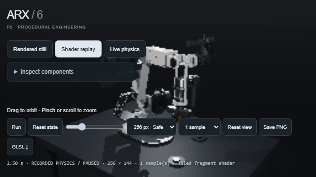

# Belt P5 portability evidence



This is a fresh WebGL2 fragment-shader render at 256x144, displayed in the viewer at recorded replay time 2.5 seconds. It is not film playback, a newly simulated motion sequence, or a claim of real-time performance. The image was visually inspected. The low-resolution check preserves the original procedural geometry and shading and uses one sample per pixel.

The [browser receipt](windows-swiftshader.json) records the Windows headless Chromium ANGLE SwiftShader backend, exact readback of all 244,896 geometry-table bytes, one completed frame, zero context losses and a 5.84-second last frame. The command exited successfully with bounded shutdown. No watchdog or security flags were changed.

The [CPU accessor receipt](accessor-contract.json) independently compares all 166,026 scalar values across three generated buffer layouts against the original literal GLSL. It checks indexing, boundaries and return conversions and pins the original packed-data hashes. It is not a GPU test. Reproduce it with:

```text
python ARX-6-P5-Shader/tools/check_webgl_accessor_contract.py
```

The standalone GLSL and physics source hashes in the browser receipt remain unchanged. The generated adapter indexes only blocks relevant to each table, removing unnecessary compiler branches without reducing geometry or features. Initial Windows/Linux context-loss and macOS probe-timeout failures remain recorded in the PR and are not erased by this local success. Hosted three-platform results are reported separately in the draft PR. This is the pinned belt P5 baseline, not the latest ARX design, full-film validation or hardware qualification.
